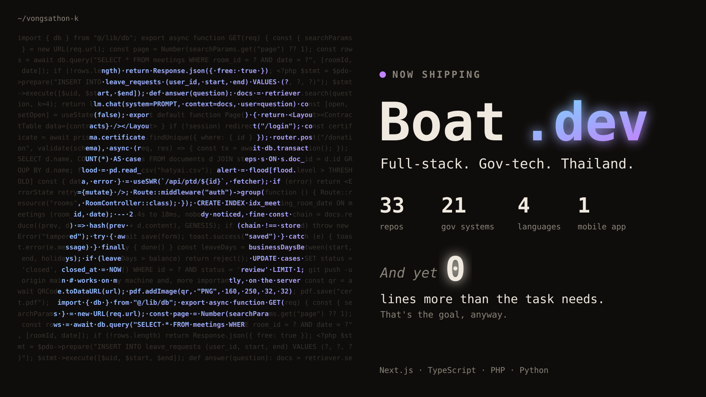

  

<h1 align="center">Boat Vongsathon</h1>

  <em>Gets a 40-page requirements doc. Ships one form. It works.</em>

  
  
  
  

  

  <strong>33 repos &middot; 21 government systems &middot; 1 mobile app</strong> 
  <strong>And yet: no more code than the task needs.</strong> 
  Most of it is private, because the people using it are public servants, not GitHub visitors.

---

You know the type. Sits near the server room. Gets asked "can the system do X?" and the answer is usually "it already does, page 2."

That's the job: internal systems for the Office of the Attorney General, built so people stop printing forms just to scan them again.

## Shipped

| Project | What it does |
| --- | --- |
| **PTD** + **PTD Mobile** | Web app and mobile app for the same work, so it gets done on the desk or on the road. |
| **Meeting reserve** | Room booking. Fewer people standing outside a room someone else booked first. |
| **Leave** & **WFH** | Leave and work-from-home requests without the paper chase. |
| **e-Donation** | Online donations, with transactions that either finish or roll back. Nothing in between. |
| **e-Phonebook** | Find a colleague's extension faster than asking the person next to you. |
| **Certificate** | Generates certificates with a QR code so anyone can check they're real. |
| **OnTrack** | Tracks whether projects are on schedule, before the deadline does it for you. |
| **AI chatbot** | Answers questions from internal documents, so the documents finally get read. |
| **Doc-chain** | Document workflow with a hash chain, so you can tell if a record was edited. |
| **Hat Yai flood** | A flood information site, built while the water was still rising. |

## Numbers

  <picture>
    <source media="(prefers-color-scheme: dark)" srcset="https://github-readme-stats.vercel.app/api?username=vongsathon-k&show_icons=true&count_private=true&hide_border=true&bg_color=0f0d0b&title_color=efe9df&text_color=8a847a&icon_color=c084fc">
    
  </picture>
  <picture>
    <source media="(prefers-color-scheme: dark)" srcset="https://streak-stats.demolab.com?user=vongsathon-k&hide_border=true&background=0f0d0b&ring=c084fc&fire=c084fc&currStreakLabel=efe9df&sideLabels=8a847a&currStreakNum=efe9df&sideNums=efe9df&dates=8a847a&stroke=36322d">
    
  </picture>

  <picture>
    <source media="(prefers-color-scheme: dark)" srcset="https://github-readme-activity-graph.vercel.app/graph?username=vongsathon-k&bg_color=0f0d0b&color=8a847a&line=c084fc&point=efe9df&area=true&area_color=7dd3fc&hide_border=true">
    
  </picture>

## How I work

Before writing code, stop at the first step that holds:

1. Does this need to exist?
2. Is it already in the codebase?
3. Does the framework already do it?
4. Does the browser or the database already do it?
5. Can it be one query, one line, one form?
6. Only then: the smallest thing that works, plus a test if it touches money, permissions or dates.

Lazy about the solution, never about reading. Validation, security and accessibility don't get cut. Government data is still people's data.

## Stack

  
  
  
  
  
  
  
  
  

## FAQ

**Why are most repos private?**
They run real systems with real people's data. You'll have to take my word for it. Or the hero image's.

**Can the system export to Excel?**
Yes. It always can. Someone always asks.

**Does it scale?**
To every staff member in the office, on the Monday morning after a long weekend. Yes.

## Contact

<!-- TODO: add your email or LinkedIn -->
Open an issue on any public repo, or find me at the office. I'm the one not printing anything.
